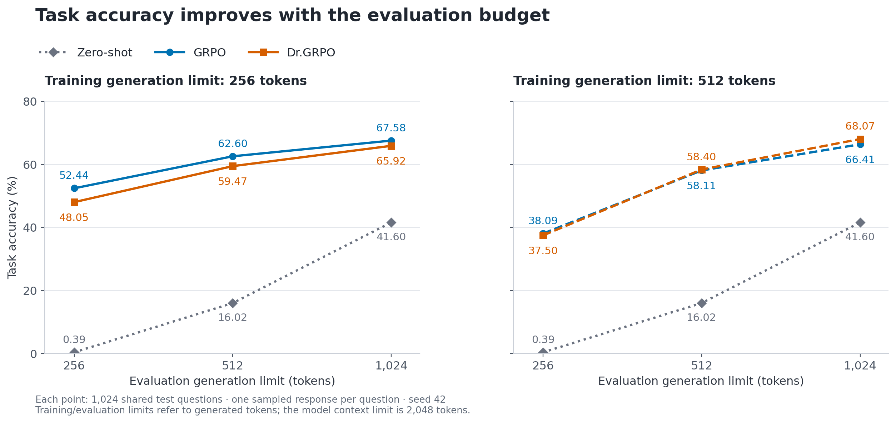
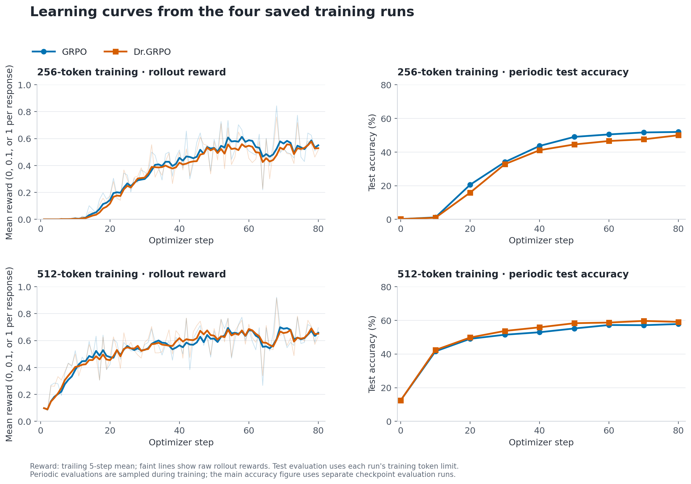
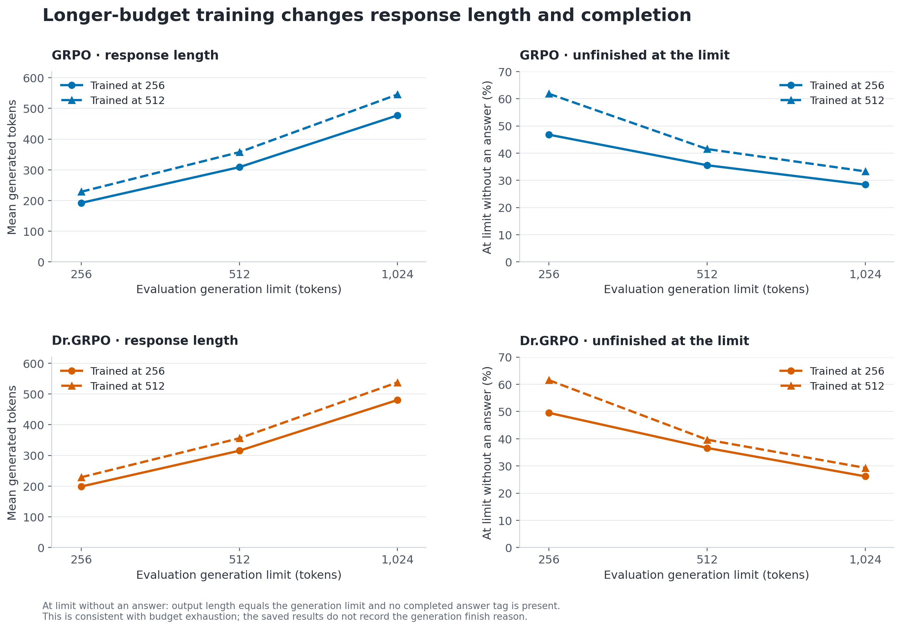
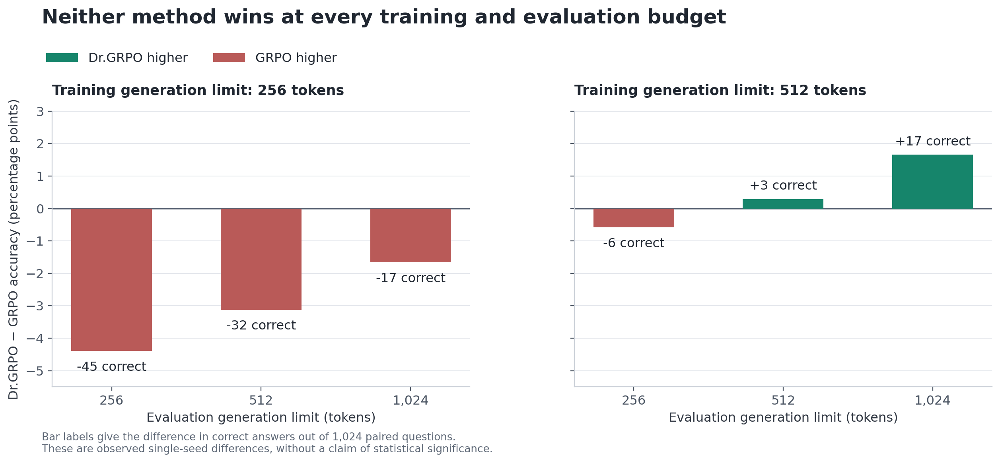
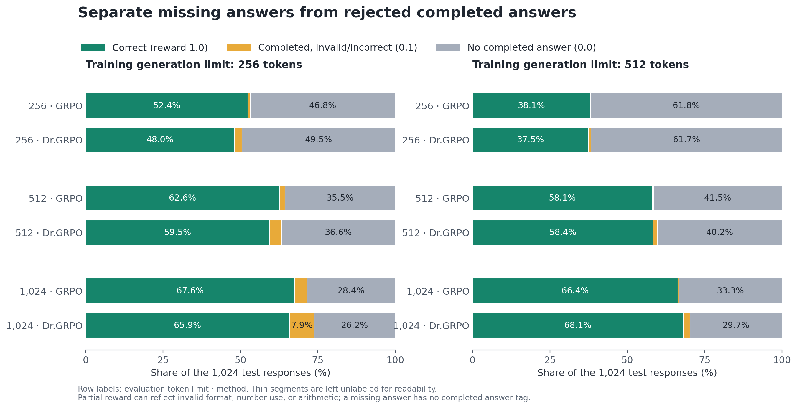

# NTI GStar Bootcamp — Assignment 2: GRPO for Countdown

## Setup

I trained `Qwen/Qwen3-1.7B` on `justinphan3110/Countdown-Tasks-3to4` using GRPO and Dr.GRPO, with generation limits of 256 and 512 tokens. Each run used 80 optimizer steps, rollout batch size 128, group size 8, 32 gradient accumulation steps, learning rate `7e-6`, and seed 42. I used Modal with gradient checkpointing enabled.

I evaluated each checkpoint and the base model on the same 1,024 test questions at generation limits of 256, 512, and 1,024 tokens. Sampling used temperature 1.0, top-p 1.0, and seed 42. These are response-generation limits; the context limit was 2,048 tokens.

The reward is 1.0 for a correct expression using every supplied number once, 0.1 for a completed answer tag with an invalid or incorrect expression, and 0.0 when no completed answer tag is found. Accuracy counts only reward-1.0 responses.

## Results

| Training seq len | Method | Accuracy at 256 seqlen | Accuracy at 512 seqlen | Accuracy at 1024 seqlen |
| --- | --- | ---: | ---: | ---: |
| - | Zero-shot | 0.39% | 16.02% | 41.60% |
| 256 | GRPO | 52.44% | 62.60% | 67.58% |
| 512 | GRPO | 38.09% | 58.11% | 66.41% |
| 256 | Dr.GRPO | 48.05% | 59.47% | 65.92% |
| 512 | Dr.GRPO | 37.50% | 58.40% | 68.07% |

All accuracies are percentages. Each trained model beats the measured 1,024-token zero-shot baseline of 41.60% when evaluated at its own training limit. The highest accuracy is 68.07%, from Dr.GRPO trained at 512 and evaluated at 1,024. These results use one training seed and one sampled answer per question.



*Figure 1. Accuracy versus evaluation generation limit. The gray line is the base model.* [PDF](figures/accuracy_vs_budget.pdf).



*Figure 2. Training reward and periodic test accuracy. Reward lines show a trailing average over up to five steps; faint lines show raw values. Each row uses its training generation limit for evaluation.* [PDF](figures/learning_curves.pdf).

Both methods improve over training. The 256-token runs initially receive very little reward, while the 512-token runs start learning earlier. Periodic evaluations use a different sampling history from the separate checkpoint evaluations, so the final values can differ. Equal optimizer steps also do not mean equal generated-token budgets.

## Why does 512-token training do worse at shorter evaluation lengths?

The models trained at 512 tend to generate longer responses and reach the evaluation limit without finishing an answer more often.

| Method | Training completion limit | Evaluation completion limit | Mean generated tokens | At token limit without a complete answer |
| --- | ---: | ---: | ---: | ---: |
| GRPO | 256 | 256 | 192.32 | 479 / 1,024 |
| GRPO | 512 | 256 | 228.52 | 633 / 1,024 |
| Dr.GRPO | 256 | 256 | 198.76 | 507 / 1,024 |
| Dr.GRPO | 512 | 256 | 228.93 | 630 / 1,024 |
| GRPO | 256 | 512 | 308.73 | 364 / 1,024 |
| GRPO | 512 | 512 | 357.50 | 425 / 1,024 |
| Dr.GRPO | 256 | 512 | 315.32 | 375 / 1,024 |
| Dr.GRPO | 512 | 512 | 355.94 | 406 / 1,024 |



*Figure 3. Response length and the percentage reaching the generation limit without a completed answer.* [PDF](figures/length_and_budget.pdf).

For example, at evaluation length 256, GRPO-256 solves 176 questions that GRPO-512 misses. All 176 corresponding GRPO-512 responses reach the cap without a completed answer. It gains 29 other correct answers, leaving 147 fewer overall.

I think training at 256 puts more pressure on the model to finish quickly. Training at 512 can reward longer successful solutions, which may then run out of room under a smaller evaluation budget. This is a likely explanation, not a controlled causal result: the prompt's requested reasoning budget changes too, and finish reasons were not saved.

More room can help: Dr.GRPO-512 reaches 68.07% at evaluation length 1,024, compared with 65.92% for Dr.GRPO-256. GRPO-512 remains slightly below GRPO-256 there.

## Why doesn't Dr.GRPO always beat GRPO?

I expected Dr.GRPO to do better, but the comparison is mixed. GRPO wins all three evaluations after 256-token training. After 512-token training, Dr.GRPO wins at evaluation lengths 512 and 1,024.



*Figure 4. Dr.GRPO minus GRPO accuracy. Labels show the difference in correct answers out of 1,024.* [PDF](figures/dr_grpo_minus_grpo.pdf).

Dr.GRPO removes group reward-standard-deviation normalization and replaces response-length normalization with a fixed denominator. These changes address biases in the objective; they do not guarantee higher accuracy for this model, task, and training budget. Both methods still use AdamW. See the [Dr.GRPO paper](https://arxiv.org/html/2503.20783v2).

GRPO can amplify small reward differences, such as 0.0 versus the 0.1 formatting reward, and gives short successful responses larger per-token weights. Those effects could help early learning under tight budgets. I have not isolated their contributions. Both methods used the same learning rate and 80 steps, without separate tuning; raw gradient scaling also does not translate directly into AdamW step size.



*Figure 5. Correct answers, completed but rejected answers, and missing completed answers.* [PDF](figures/answer_outcomes.pdf).

The method difference is not only about running out of tokens. For 256-token training evaluated at 1,024, Dr.GRPO has fewer missing answers than GRPO (268 versus 291), but more completed answers receiving partial reward (81 versus 41). Neither method wins everywhere, and these single-seed results do not establish a general ranking.

## Example generations

These are selected examples, not a random sample. The [saved cases](eval_results/report_examples.json) contain the full responses, source files, and zero-based indices. Outputs below are excerpts.

1. **Compact success — GRPO, train/eval 256/256, example 8.** Numbers `[78, 45, 50]`, target 73; 101 tokens, reward 1.0.

   `<answer>78 - 50 + 45</answer>`

   The expression uses every number once and gives `28 + 45 = 73`.

2. **Four-number success — Dr.GRPO, 512/1024, example 11.** Numbers `[51, 86, 42, 14]`, target 91; 237 tokens, reward 1.0.

   `<answer>(86 - 51) + (42 + 14)</answer>`

   The two parts give 35 and 56, which sum to 91. The response leaves its `<think>` tag unclosed, but the verifier only requires the completed answer.

3. **Unfinished answer — GRPO, 512/256, example 8.** This is the same question as example 1; 256 tokens, reward 0.0. The response ends:

   `Wait, maybe 45 + 50 = 95, then 95 - 78 = 17. Still`

   It spends the budget exploring combinations without returning an answer tag.

4. **Reasoning/final-answer mismatch — GRPO, 512/512, example 761.** Numbers `[21, 93, 12, 25]`, target 85; 335 tokens, reward 0.1.

   `<answer>(21 + 12) + (93 - 25)</answer>`

   The reasoning finds `93 - (21 + 12) + 25 = 85`, but the final expression gives 101. Correct intermediate reasoning did not lead to a correct final answer.

5. **Format rejection — Dr.GRPO, 256/512, example 222.** Numbers `[30, 42, 28]`, target 20; 385 tokens, reward 0.1.

   `<answer>(28 * 30) / 42 = 20</answer>`

   The calculation is correct, but the checker expects an expression without `= 20`. It also counts 20 as an extra number. Normalizing a validated `= target` suffix could reduce this kind of rejection.

## Conceptual questions

### 1. When is clipping more important?

Clipping is more important with off-policy or stale responses, where the generating policy differs from the current learner. The ratio is

$$
\rho = \frac{\pi_{\mathrm{current}}(o_t\mid q,o_{<t})}{\pi_{\mathrm{behavior}}(o_t\mid q,o_{<t})}.
$$

Fresh on-policy ratios start at one. Stale samples can have ratios farther from one, making the unclipped surrogate unstable. Clipping limits the incentive for advantage-favored changes; it does not force the actual ratio to stay inside the interval.

In my loop, `old_log_probs = policy_log_probs.detach()` makes the ratio numerically one, so clipping is inactive. Gradients still flow through the numerator. In general PPO, multiple updates on a fresh batch can move ratios away from one, so clipping can still matter. Actual off-policy reuse would require saving behavior-policy log probabilities. [PPO reference](https://arxiv.org/abs/1707.06347).

### 2. Two advantages of each policy regime

| Regime | Advantage | Why it helps here |
| --- | --- | --- |
| On-policy | Less policy mismatch | Fresh responses reflect the current model's errors, with ratios initially near one. |
| On-policy | Simpler bookkeeping | No replay buffer mixing policy versions or stale-response corrections. |
| Off-policy | Reuse generated responses | More learner updates can share the cost of expensive reasoning rollouts. |
| Off-policy | Overlap generation and learning | Separate actors and learners can reduce idle time, although responses may become stale. |

My runs use fresh rollouts, not replay or asynchronous actors.

### 3. Gradients for three-token and six-token responses

I ran `backward()` on CPU in float64 with batch size 2, maximum response length 6, probability ratios 1, advantages `+1`, and clip range 0.2. The masks were `[1,1,1,0,0,0]` and `[1,1,1,1,1,1]`. Advantages were fixed to isolate the reductions, without group normalization.

Inside the unclipped region, the valid-token gradients with respect to the probability ratio are `−A/(B*T_i)` for `masked_mean` and `−A/(B*C)` for Dr.GRPO, where `T_i` is response length and `C` is the fixed maximum.

| Reduction | Short-response valid-token gradient | Short-response masked-token gradient | Long-response valid-token gradient | Scalar loss |
| --- | ---: | ---: | ---: | ---: |
| `masked_mean` | −1/6 ≈ −0.166667 | 0 | −1/12 ≈ −0.083333 | −1.00 |
| `masked_mean_drgrpo` | −1/12 ≈ −0.083333 | 0 | −1/12 ≈ −0.083333 | −0.75 |

The short response gets twice the per-token gradient under `masked_mean`. Dr.GRPO gives every valid token the same coefficient. Masked tokens have zero gradient in both. Setting the advantages to `−1` reverses the signs and preserves the magnitudes. These are token coefficients, not guaranteed parameter-gradient norms.

The ratios were leaf tensors; I passed their logarithms into `compute_loss`, called each reduction, then inspected `ratios.grad`. The experiment is in [gradient_comparison.py](gradient_comparison.py), with [recorded results](eval_results/gradient_comparison.json).

### 4. When would I prefer each reduction?

- **`masked_mean`:** When short and long solutions should each receive equal total scalar weight as training examples. Averaging within a response prevents a six-token solution from getting twice the total coefficient just because it is longer.
- **`masked_mean_drgrpo`:** When token weights should stay consistent, including for long unsuccessful reasoning. A fixed denominator avoids reducing each bad token's penalty simply because the response is longer. It preserves the summed sequence-gradient weighting up to a constant, without guaranteeing better accuracy.

## Reproducibility and limitations

The [accuracy sources](eval_results/accuracy_table.md), [example records](eval_results/report_examples.json), and [plot data](figures/evaluation_summary.csv) contain the underlying measurements. Results were checked against saved counts and individual rewards. There is one training seed and one sampled answer per question, so the smaller differences may not be reliable.

To regenerate the five plots in PNG, PDF, and SVG:

```bash
python -m venv .venv-plots
.venv-plots/bin/python -m pip install -r requirements-plots.txt
.venv-plots/bin/python plot_results.py
```
